  

  
  
  

  

## Sobre mim

Desenvolvo bots para Discord, APIs e painéis web. Trabalho com TypeScript e JavaScript, do comando que o bot recebe no chat à interface que apresenta os dados.

- **Bots e APIs.** Uso discord.js para os bots e Node.js com Express para as APIs.
- **Web e automação.** Faço painéis com React e Next.js e automatizo coletas e publicações com GitHub Actions.
- **Fora do navegador.** Exploro Lua e ImGui para criar overlays.

## Tecnologias

  
  
  
  
  
  

  
  
  
  
  
  

## Projeto em destaque

### Repo Pulse

Criei o Repo Pulse para acompanhar como um repositório muda ao longo do tempo. Cada leitura guarda as métricas da API do GitHub e o commit que estava na branch padrão naquele momento.

O gráfico mostra as coletas dos últimos **7, 30 ou 90 dias**. No histórico, você pode abrir o commit de uma leitura ou baixar os dados em JSON.

**[Abrir o painel](https://0nqj.github.io/repo-pulse/)** · [Explorar o código](https://github.com/0nqj/repo-pulse) · [Consultar o histórico](https://0nqj.github.io/repo-pulse/#historico)

  

  
  
  

## Vamos construir algo?

Gosto de colaborar em bots, automações e ferramentas para desenvolvedores. Para falar comigo no Discord, procure por `@onqj`, com a letra **o**.

[Ver meus repositórios no GitHub](https://github.com/0nqj?tab=repositories)
