<!--
  Profile README for github.com/0nqj
  Visual assets are stored locally; live badges use public GitHub data.
-->

  

  
  
  

  

## Sobre mim

Desenvolvo sistemas que transformam ideias em experiências funcionais — de bots e automações a APIs, dashboards, overlays e interfaces. Gosto de unir experimentação rápida, código claro e processos que podem ser medidos e melhorados.

- **Foco:** automação, bots para Discord, aplicações web e ferramentas para desenvolvedores.
- **Stack principal:** TypeScript, JavaScript, Node.js, Next.js, React e Express.
- **Também exploro:** Lua, overlays e interfaces com ImGui.
- **Objetivo:** evoluir continuamente e colaborar em projetos ambiciosos, úteis e bem construídos.

## Tecnologias

  
  
  
  
  
  
  
  
  
  
  
  

## Projeto em destaque

<table>
  <tr>
    <td width="62%" valign="top">
      <h3><a href="https://github.com/0nqj/repo-pulse">Repo Pulse</a></h3>
      
Painel público de telemetria para repositórios GitHub, construído para tornar atividade e evolução visíveis sem simular trabalho humano.

      <ul>
        <li>Oito leituras diárias de métricas reais.</li>
        <li>Histórico de aproximadamente 180 dias.</li>
        <li>Coleta e deploy automatizados com GitHub Actions.</li>
        <li>Next.js, TypeScript, testes e publicação no GitHub Pages.</li>
      </ul>
      

        <a href="https://github.com/0nqj/repo-pulse"><strong>Ver código →</strong></a>
        &nbsp;&nbsp;·&nbsp;&nbsp;
        <a href="https://0nqj.github.io/repo-pulse/"><strong>Abrir painel →</strong></a>
      

    </td>
    <td width="38%" align="center" valign="middle">
      
    </td>
  </tr>
</table>

  
  
  

## Vamos construir algo?

Estou aberto a colaborações em automações, bots, dashboards, interfaces e ferramentas para desenvolvedores.

  
  

  Clareza no código. Automação no processo. Evolução contínua.

