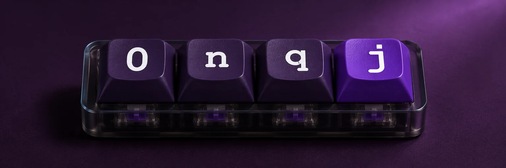

# 0nqj / 範

Escrevo bots para Discord e desenvolvo ferramentas web em TypeScript e JavaScript. Uso discord.js nos bots, Node.js e Express nas APIs, e React e Next.js nos painéis. Também experimento com Lua e ImGui para criar overlays.

## Um projeto meu

Criei o **Repo Pulse** para acompanhar como um repositório muda ao longo do tempo. Cada coleta guarda as métricas do GitHub e o commit que estava na branch padrão naquele momento. No histórico, dá para escolher uma leitura e abrir o código daquela versão.

[Abrir o painel](https://0nqj.github.io/repo-pulse/) · [Explorar o código do Repo Pulse](https://github.com/0nqj/repo-pulse)

## Contato

Gosto de colaborar em bots, automações e ferramentas para desenvolvedores. No Discord, meu usuário é `@onqj`, com a letra **o**.

[Ver meus repositórios no GitHub](https://github.com/0nqj?tab=repositories)
